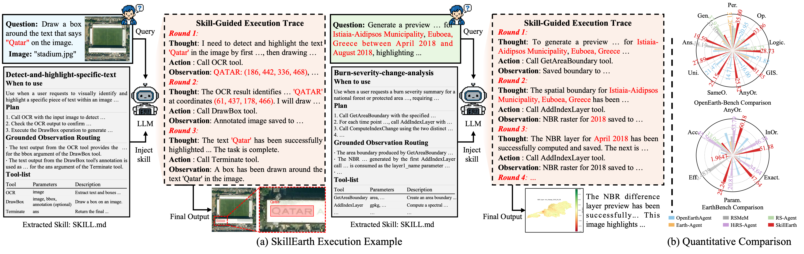
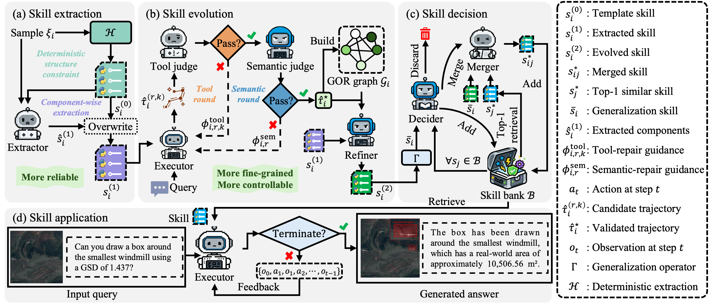

<div align="center">

<p>
  
</p>

<p>
  
</p>

<p>
  
</p>

<p>
  <b>Haojun Tang</b><sup>1,2</sup> &nbsp;·&nbsp;
  <b>Wenda Zhao</b><sup>2,✉</sup> &nbsp;·&nbsp;
  <b>Xiang Zhou</b><sup>2</sup> &nbsp;·&nbsp;
  <b>Qiwei Lin</b><sup>3</sup> &nbsp;·&nbsp;
  <b>Lida Huang</b><sup>1</sup> &nbsp;·&nbsp;
  <b>Yan Wang</b><sup>1,✉</sup>
</p>

<p>
  <sup>1</sup> Institute for AI Industry Research (AIR), Tsinghua University<br>
  <sup>2</sup> Dalian University of Technology<br>
  <sup>3</sup> Beijing Institute of Radio Measurement
</p>

<p>
  <a href="#"></a>
  <a href="https://arxiv.org/abs/2611.15481"></a>
  <a href="https://huggingface.co/XinRan-Tang/skillbank-oea"></a>
  <a href="https://huggingface.co/XinRan-Tang/skillbank-eb"></a>
</p>

<sub>✉ Corresponding authors</sub>

</div>

<p align="center">
  
</p>

<p align="justify" style="margin-top: -10px;">
<span style="color: gray; font-size: 14px;"><b>Figure 1.</b> Teaser of SkillEarth. (a) Skill-guided execution examples showing how extracted skills guide multi-step tool execution. (b) Quantitative comparisons with existing RS agents on <a href="https://github.com/mbzuai-oryx/OpenEarthAgent" style="color: #00A9E8;">OpenEarth-Bench</a> (End-to-end mode) and <a href="https://github.com/opendatalab/Earth-Agent" style="color: #00A9E8;">Earth–Bench</a> (IF mode).</span>
</p>

## 📖 &nbsp; Overview

<div align="justify">

Recently developed remote sensing (RS) agents execute real-world tasks with complex workflows through multi-step tool invocation. These agents, however, typically rely on predefined expertise or parameter updates. They thus require updating expert knowledge or retraining models whenever new tools, tasks, or execution patterns emerge, limiting their continual adaptability in dynamic Earth environments. In this work, we seek to equip general-purpose agents with RS tool-call knowledge that can be automatically extracted from demonstrated trajectories without expert intervention or parameter updates. Specifically, we propose <span style="color: #00A9E8;"><b>SkillEarth</b></span>, a self-evolving skill extraction method that externalizes RS tool-call knowledge as reusable, retrievable, and evolvable skill files and refines them through <span style="color: #00A9E8;"><b>observation-grounded evolution</b></span>. Unlike existing automatic skill extraction methods that rely on outcome-based reflection to refine skills holistically, SkillEarth grounds skill evolution in real tool-chain execution and combines <span style="color: #00A9E8;"><b>dual-judge feedback with a grounded observation routing (GOR) graph</b></span> for precise component-level refinement. The resulting skills are <span style="color: #00A9E8;"><b>generalizable, reliable, and transferable</b></span>: they improve overall RS tool-call performance across three frontier LLMs and four open-source LLMs, are refined through real tool execution feedback, and support cross-model reuse without retraining. Experiments on OpenEarth-Bench and Earth-Bench demonstrate that SkillEarth achieves better tool selection, argument correctness, execution-order consistency, and task completion than existing RS agents and skill extraction methods.

</div>

## 📢 &nbsp; Latest Updates

- **2026-11-15** — The skill-extraction framework is coming soon. 🔥
- **2026-11-15** — Inference and evaluation scripts are now available for reproducing our results. 🚀
- **2026-11-14** — We release our SkillBanks: [`skillbank-oea`](https://huggingface.co/XinRan-Tang/skillbank-oea) and [`skillbank-eb`](https://huggingface.co/XinRan-Tang/skillbank-eb). 🎉
- **2026-11-11** — Our paper,[SkillEarth: Teaching General-Purpose Agents to Act on Earth via Skill Evolution](https://arxiv.org/abs/2611.15481), is now available. 🎉

## 📦 &nbsp; Released SkillBanks

Download our released SkillBanks for direct use or further development.

<div align="center">
<table align="center">
  <thead>
    <tr>
      <th align="center">Skill bank</th>
      <th align="center">Benchmark</th>
      <th align="left">Backbones</th>
      <th align="center">Link</th>
    </tr>
  </thead>
  <tbody>
    <tr>
      <td align="center"><strong>skillbank-oea</strong></td>
      <td align="center">OpenEarth-Bench</td>
      <td align="left">
         <a href="https://developers.openai.com/api/docs/models/gpt-5.6-terra">GPT-5.6-Terra</a><br>
         <a href="https://lf3-static.bytednsdoc.com/obj/eden-cn/lapzild-tss/ljhwZthlaukjlkulzlp/seed2/0214/Seed2.0%20Model%20Card.pdf">Doubao-Seed-2.0-Mini</a><br>
         <a href="https://fe-static.deepseek.com/chat/transparency/deepseek-V4-model-card-EN.pdf">DeepSeek-V4-Flash</a><br>
         <a href="https://huggingface.co/deepseek-ai/DeepSeek-R1">DeepSeek-R1</a><br>
         <a href="https://huggingface.co/Qwen/Qwen2.5-7B-Instruct">Qwen2.5-7B-Instruct</a><br>
         <a href="https://huggingface.co/Qwen/Qwen3-4B-Instruct-2507">Qwen3-4B-Instruct</a><br>
         <a href="https://huggingface.co/mistralai/Mistral-7B-Instruct-v0.3">Mistral-v0.3-Instruct</a>
      </td>
      <td align="center"><a href="https://huggingface.co/XinRan-Tang/skillbank-oea">🤗 Hugging Face</a></td>
    </tr>
    <tr>
      <td align="center"><strong>skillbank-eb</strong></td>
      <td align="center">Earth-Bench</td>
      <td align="left">
         <a href="https://huggingface.co/Qwen/Qwen3-4B-Instruct-2507">Qwen3-4B-Instruct</a>
      </td>
      <td align="center"><a href="https://huggingface.co/XinRan-Tang/skillbank-eb">🤗 Hugging Face</a></td>
    </tr>
  </tbody>
</table>
</div>

By default, the agent retrieves the top-1 skill based on cosine similarity during inference. Alternatively, you can integrate these skills into your own harness, such as `Codex` or `Claude Code`.

## 🧠 &nbsp; Method
<p align="center">
  
</p>

<p align="justify" style="margin-top: -10px;">
<span style="color: gray; font-size: 14px;"><b>Figure 2.</b> Overview of SkillEarth. (a) The Extractor constructs component-wise skills by overwriting templates with LLM-inferred
components. (b) The Evolver validates and refines skills using dual-judge feedback and GOR graphs. (c) The Decider merges, discards,
or adds skills to the skill bank. (d) During application, the Executor uses retrieved skills to generate final answers.</span>
</p>

Unlike prior skill-extraction methods, SkillEarth represents each skill as six independently editable components, `s = (n, d, w, p, r, ℓ)`:

<div align="center">
  <table>
    <thead>
      <tr>
        <th>Component</th>
        <th>Meaning</th>
        <th align="center">Editable</th>
      </tr>
    </thead>
    <tbody>
      <tr><td><code>n</code></td><td>skill name</td><td align="center">✓</td></tr>
      <tr><td><code>d</code></td><td>skill description</td><td align="center">✓</td></tr>
      <tr><td><code>w</code></td><td>when-to-use (activation condition) </td><td align="center">✓</td></tr>
      <tr><td><code>p</code></td><td>execution plan</td><td align="center">✓</td></tr>
      <tr><td><code>r</code></td><td>grounded observation routing (output → argument bindings)</td><td align="center">✓</td></tr>
      <tr><td><code>ℓ</code></td><td>required tools and their argument schemas</td><td align="center">✗ (fixed from the trajectory)</td></tr>
    </tbody>
  </table>
</div>


<p align="justify">
Each component is an independent Python object and is written to <code>SKILL.md</code> only during final rendering. Skill evolution proceeds in three stages:

1. <span style="color: #00A9E8;"><b>Component-wise Skill Extraction.</b></span> Each component is independently extracted from demonstration trajectories, yielding a controllable structure that supports subsequent evolution.
2. <span style="color: #00A9E8;"><b>Observation-Grounded Skill Evolution.</b></span> Real tool executions, dual-judge feedback, and the GOR graph localize failures and guide targeted skill revisions.
3. <span style="color: #00A9E8;"><b>Skill Decision.</b></span> The system decides whether an evolved skill should be added to the bank, merged with an existing skill, or discarded.

The resulting SkillBank is backbone-agnostic and can be reused across LLMs. Explore the released banks: `skillbank-oea` for OpenEarth-Bench and `skillbank-eb` for Earth-Bench.
</p>


## ✨ &nbsp; Key Features
### 1. Generalization

Skill guidance improves remote-sensing task performance across <span style="color: #00A9E8;"><b>three frontier models</b></span> (GPT-5.6-Terra, Doubao-Seed-2.0-Mini, and DeepSeek-V4-Flash) and <span style="color: #00A9E8;"><b>four open-source models</b></span> (Mistral-v0.3-Instruct, DeepSeek-R1, Qwen2.5-7B-Instruct, and Qwen3-4B-Instruct). The paper reports the complete metric breakdown.
<p align="center">
  
</p>

<p align="justify" style="margin-top: -10px;">
  <span style="color: gray; font-size: 14px;"><b>Figure 3.</b> End-to-end task execution results on OpenEarth-Bench for different LLMs (three frontier and four open-source models), with and without skill guidance.</span>
</p>


### 2. Cross-Model Transfer

Extracted skills transfer bidirectionally across model families, improving both frontier and open-source models on OpenEarth-Bench. The full step-by-step and end-to-end transfer results are provided below. **Bold** indicates the best result within each evaluation model. "—" denotes the baseline without skill guidance.

<details>
<summary><b>🔹 Frontier → Open-source: Qwen3-4B-Instruct</b></summary>

#### Step-by-Step Skill Transfer

| Skill Source | Inst. ↑ | Tool. ↑ | ArgN. ↑ | ArgV. ↑ | Summ. ↑ |
| :--- | ---: | ---: | ---: | ---: | ---: |
| — (w/o skill) | 98.47 | 87.70 | 84.33 | 33.67 | 92.55 |
| Doubao-Seed-2.0-Mini | 98.66 | **91.31** | **86.97** | **37.12** | **94.46** |
| DeepSeek-V4-Flash | 98.47 | 90.26 | 86.94 | 37.07 | 93.22 |
| GPT-5.6-Terra | **98.80** | 90.53 | 86.82 | 36.20 | 93.04 |

#### End-to-End Skill Transfer

| Skill Source | Per. ↑ | Op. ↑ | Logic. ↑ | GIS. ↑ | AnyOr. ↑ | SameO. ↑ | Uni. ↑ | Ans. ↑ | Gen. ↑ |
| :--- | ---: | ---: | ---: | ---: | ---: | ---: | ---: | ---: | ---: |
| — (w/o skill) | 13.31 | 12.54 | 11.80 | 76.42 | 15.23 | 14.63 | 18.48 | 16.94 | 7.59 |
| Doubao-Seed-2.0-Mini | **33.14** | **33.58** | **23.82** | **80.23** | **23.95** | **23.78** | **27.20** | **21.26** | **23.45** |
| DeepSeek-V4-Flash | 23.98 | 25.58 | 20.09 | 77.53 | 22.07 | 21.73 | 24.12 | 18.92 | 18.62 |
| GPT-5.6-Terra | 29.26 | 31.69 | 18.48 | 76.21 | 20.62 | 20.36 | 22.93 | 17.32 | 22.76 |

</details>

<details>
<summary><b>🔹 Open-source → Frontier: DeepSeek-V4-Flash</b></summary>

#### Step-by-Step Skill Transfer

| Skill Source | Inst. ↑ | Tool. ↑ | ArgN. ↑ | ArgV. ↑ | Summ. ↑ |
| :--- | ---: | ---: | ---: | ---: | ---: |
| — (w/o skill) | 99.78 | 84.92 | 78.90 | 40.32 | 96.64 |
| Qwen3-4B-Instruct | 99.92 | 89.08 | 81.59 | **43.41** | 96.70 |
| Qwen2.5-7B-Instruct | **99.98** | **89.77** | **82.15** | 43.24 | **96.79** |

#### End-to-End Skill Transfer

| Skill Source | Per. ↑ | Op. ↑ | Logic. ↑ | GIS. ↑ | AnyOr. ↑ | SameO. ↑ | Uni. ↑ | Ans. ↑ | Gen. ↑ |
| :--- | ---: | ---: | ---: | ---: | ---: | ---: | ---: | ---: | ---: |
| — (w/o skill) | 26.05 | **38.51** | 13.11 | 82.27 | 50.90 | 50.21 | 56.54 | 53.41 | 55.86 |
| Qwen3-4B-Instruct | **40.84** | 37.60 | 31.91 | 81.79 | **57.74** | **57.31** | **62.70** | **60.22** | **62.07** |
| Qwen2.5-7B-Instruct | 40.67 | 35.96 | **36.18** | **82.65** | 56.72 | 56.29 | 61.93 | 60.13 | 61.38 |

</details>

## 🚀 &nbsp; Quick Start

### 🛠️ &nbsp; 1. Environment Setup

SkillEarth requires one environment for the planning model and separate tool-call environments for OpenEarth-Bench and Earth-Bench. Install **vLLM** for local LLM deployment (skip this step if using third-party LLM APIs).

#### 1.1 LLM environment (vLLM)

```bash
export PROJECT_ROOT=SkillEarth
cd "$PROJECT_ROOT"

conda create -n vllm python=3.10 -y
conda activate vllm
python -m pip install --upgrade pip
pip install -r requirements/vllm.txt
```
</details>

#### 1.2 OpenEarth-Bench tool-call environments

OpenEarth-Bench requires three separate conda environments:

- **`tool-server-e1`**: Controller and core workers.
- **`tool-server-e2`**: Change detection.
- **`tool-server-e3`**: Object detection.

Installation scripts are available in [`requirements/oea/`](requirements/oea/).

<details>
<summary><b>tool-server-e1 (main server + core workers)</b></summary>

```bash
conda create -n tool-server-e1 python=3.10 -y
conda activate tool-server-e1
python -m pip install --upgrade pip
pip install torch==2.5.1 torchvision==0.20.1 torchaudio==2.5.1 \
  --index-url https://download.pytorch.org/whl/cu121
conda install -c conda-forge qgis -y
pip install -r requirements/oea/tool-server-e1.txt
```
</details>

<details>
<summary><b>tool-server-e2 (ChangeDetection)</b></summary>

```bash
conda create -n tool-server-e2 python=3.10 -y
conda activate tool-server-e2
pip install torch==2.1.0 torchvision==0.16.0 torchaudio==2.1.0 \
  --index-url https://download.pytorch.org/whl/cu121
pip install -r requirements/oea/tool-server-e2.txt
```
</details>

<details>
<summary><b>tool-server-e3 (ObjectDetection)</b></summary>

```bash
conda create -n tool-server-e3 python=3.10 -y
conda activate tool-server-e3
pip install torch==2.5.1 torchvision==0.20.1 torchaudio==2.5.1 \
  --index-url https://download.pytorch.org/whl/cu121
pip install --extra-index-url https://miropsota.github.io/torch_packages_builder \
  mmcv==2.2.0+pt2.5.1cu121
pip install -r requirements/oea/tool-server-e3.txt
```
</details>

Then make the `conda_env` values in `tool_server/oea/tool_workers/scripts/launch_scripts/config/skillearth.yaml` match the environment names above:

```yaml
ChangeDetection: tool-server-e2
ObjectDetection: tool-server-e3
```

Finally, download the required pretrained weights (GroundingDINO, Qwen3-VL-8B, SAM 2.1, TEOChat, LAE-DINO, and EasyOCR) and configure the Google Earth Engine key according to [the OpenEarth-Bench model guide](models/oea/oea.md).

#### 1.3 Earth-Bench tool-call environment

Create a dedicated environment and install the Earth-Bench dependencies.

```bash
conda create -n tool-server-eb python=3.10 -y
conda activate tool-server-eb
conda install -c conda-forge gdal=3.4.1 -y
pip install -r requirements/eb/requirements.txt
```

Before running Earth-Bench, download its required pretrained weights by following [the Earth-Bench model guide](models/eb/eb.md).

### 🗂️ &nbsp; 2. Benchmark Download

#### 2.1 OpenEarth-Bench

Follow the complete setup instructions in [the OpenEarth-Bench dataset guide](datasets/oea/README.md). The `data/` directory contains the original official [OpenEarthAgent dataset](https://huggingface.co/datasets/MBZUAI/OpenEarthAgent), including the images required by the trajectories.

For reproducible SkillBank construction, we additionally provide a prepared training subset containing `train_split.json` and `train_gpkgs/`. `train_split.json` fixes the 1,050 demonstrated trajectories used for skill extraction, while `train_gpkgs/` provides their GeoPackage tool caches.

> Download the prepared subset from [training subset](https://drive.google.com/file/d/1CXuwvm4PzLpgowDqKayp9d0jNcqzvnwR/view?usp=sharing) and extract it under `datasets/oea/`. The original official dataset must be placed under `datasets/oea/data/` as described in the dataset guide.

#### 2.2 Earth-Bench

Follow [the Earth-Bench dataset guide](datasets/eb/README.md) to download the official scene data and place it under `datasets/eb/Earth-Bench/benchmark/data/`. The guide also specifies the required locations for `question.json` and `extracted_tool_calls_GT.json`.

### 🧪 &nbsp; 3. Run Inference

Now, everything is ready! You can apply a released SkillBank to remote-sensing tasks. Select a benchmark, then launch the planning-model server and the corresponding tool service in separate terminals before running inference.

> 💡 **Configure before running.** Replace `Path/to/SkillEarth` with your local repository path in the relevant scripts. For local LLMs, configure the model-weight path and `CUDA_VISIBLE_DEVICES`. For third-party LLM APIs, configure the endpoint and API key instead.

#### 3.1 Start a planning LLM

For a local qwen model, edit the model path and GPU setting in [`scripts/model/start_qwen_vllm.sh`](scripts/model/start_qwen_vllm.sh), then start the vLLM server:

```bash
conda activate vllm
cd /path/to/SkillEarth
bash scripts/model/start_qwen_vllm.sh
```

Alternative launchers for [DeepSeek-R1](scripts/model/start_deepseek_r1_vllm.sh) and [Mistral](scripts/model/srart_mistral_vllm.sh) are also provided. If you use a third-party LLM API, skip this step and configure its API endpoint, model identifier, and API key in the selected inference or evaluation script.

#### 3.2 Start the tool service

Open a second terminal and activate the appropriate tool environment. Keep both the model service and tool service running throughout inference or evaluation.

<details>
<summary><b>🛰️ OpenEarth-Bench</b></summary>

```bash
conda activate tool-server-e1
cd /path/to/SkillEarth
bash scripts/tools/run_tools_oea.sh
```

The controller listens on `http://127.0.0.1:20001`. Confirm that all workers are ready in [`tool_server/oea/tool_workers/logs/server_log/`](tool_server/oea/tool_workers/logs/server_log/).
</details>

<details>
<summary><b>🌍 Earth-Bench</b></summary>

Before launching, update the conda-environment paths, GPU ID, model locations, and any required API key at the top of [`scripts/tools/run_tools_eb.sh`](scripts/tools/run_tools_eb.sh).

```bash
cd /path/to/SkillEarth
bash scripts/tools/run_tools_eb.sh
```

Monitor service readiness in [`tool_server/eb/logs/run_tools_eb.log`](tool_server/eb/logs/run_tools_eb.log).
</details>

#### 3.3 Run an example task

The demo scripts retrieve the most relevant skill from the downloaded SkillBank and use it to guide multi-step tool calling. Before execution, edit the query, image path, model endpoint, and SkillBank path at the top of the selected script.

```bash
cd /path/to/SkillEarth

# 🛰️ OpenEarth-Bench example
bash scripts/inference/inference_oea.sh

# 🌍 Earth-Bench example
bash scripts/inference/inference_eb.sh
```

Each script writes an agent trace to its configured output directory. Tool outputs are available under [`tool_server/oea/tool_workers/tools_output/`](tool_server/oea/tool_workers/tools_output/) and [`tool_server/eb/tool_outputs/`](tool_server/eb/tool_outputs/).

### 📊 &nbsp; 4. Evaluation

We provide evaluation scripts for both benchmarks so you can reproduce the reported metrics with your own model endpoint or a supported third-party model. Keep the selected model service and corresponding tool service online throughout the run.

> 📁 **Reported results:** Complete SkillEarth evaluation results are available in [`evaluation_results/`](evaluation_results/).

> ✅ **Before evaluation:** set the repository root, model name, SkillBank path, endpoint/API key, and GPU settings at the top of the relevant evaluation script.

#### 4.1 OpenEarth-Bench

Use the local scripts for an open-weight model served through vLLM, or the cloud scripts for a frontier model.

```bash
cd /path/to/SkillEarth

# 🖥️ Local model: step-by-step and end-to-end evaluation
bash scripts/eval/oea/local_eval_step.sh
bash scripts/eval/oea/local_eval_e2e.sh

# ☁️ Hosted model: step-by-step and end-to-end evaluation
bash scripts/eval/oea/cloud_eval_step.sh
bash scripts/eval/oea/cloud_eval_e2e.sh
```

#### 4.2 Earth-Bench

Earth-Bench evaluation follows four stages: generate agent trajectories, parse them, compute step-by-step metrics, and compute end-to-end metrics.

```bash
cd /path/to/SkillEarth

# 1. Generate agent trajectories
bash scripts/eval/eb/trajectory.sh

# 2. Parse trajectories for metric computation
bash scripts/eval/eb/process.sh

# 3. Compute step-by-step metrics
bash scripts/eval/eb/local_eval_step.sh

# 4. Compute end-to-end metrics
bash scripts/eval/eb/local_eval_e2e.sh
```

## 📚 &nbsp; Citation

If you find SkillEarth useful, please cite:

```bibtex
@misc{tang2026skillearthteachinggeneralpurposeagents,
      title={SkillEarth: Teaching General-Purpose Agents to Act on Earth via Skill Evolution}, 
      author={Haojun Tang and Wenda Zhao and Xiang Zhou and Qiwei Lin and Lida Huang and Yan Wang},
      year={2026},
      eprint={2611.15481},
      archivePrefix={arXiv},
      primaryClass={cs.AI},
      url={https://arxiv.org/abs/2611.15481}, 
}
```

## 🙏 &nbsp; Acknowledgement

We sincerely thank the authors and maintainers of [OpenEarthAgent](https://github.com/mbzuai-oryx/OpenEarthAgent) and [Earth-Agent](https://github.com/opendatalab/Earth-Agent) for their pioneering work and for releasing the codebases, benchmarks, datasets, and evaluation resources that support this research. SkillEarth builds upon the OpenEarth-Bench and Earth-Bench evaluation ecosystems.
